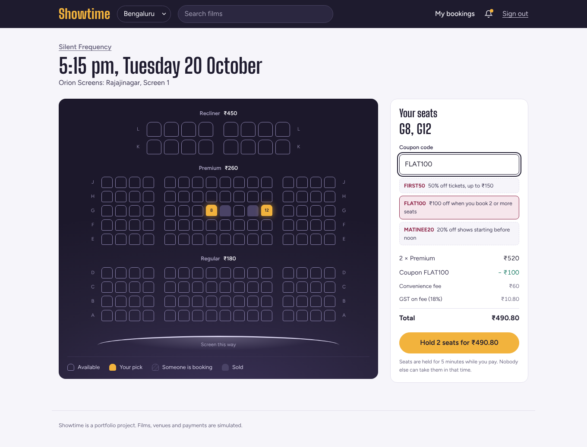
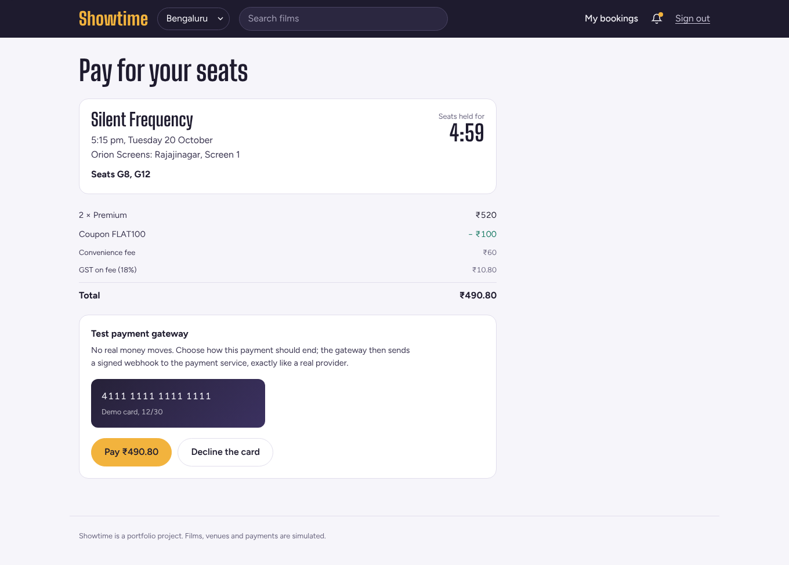
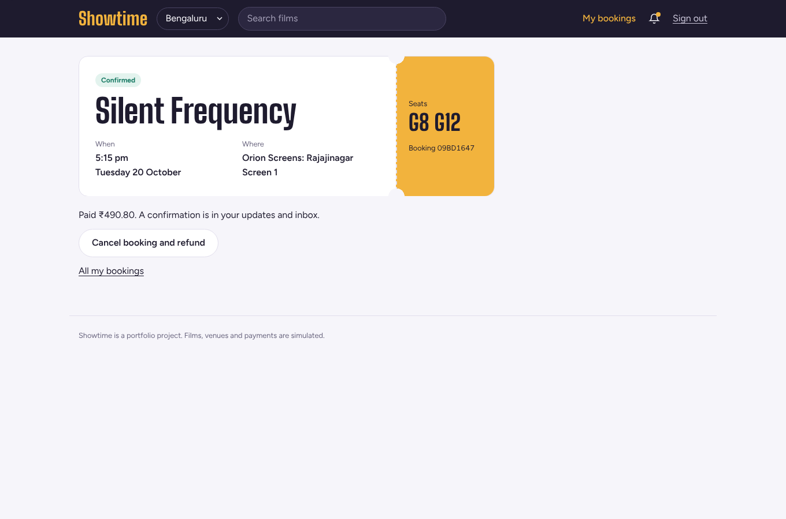
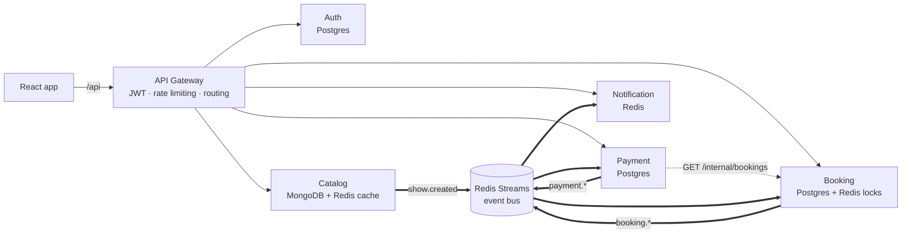

# Showtime 🎬
[](https://github.com/Tejasvi-hegde/movie-booking/actions/workflows/ci.yml)
A movie ticket booking platform (BookMyShow-style) built as **six microservices**. The interesting part is the hard problem underneath: **thousands of people clicking the same seat at the same moment, and nobody ever getting double-booked**, with payments that can fail, arrive late or be retried.

> 100 users firing a hold on the same seat at the same instant → **exactly 1 succeeds, 99 get a clean 409**.
> 100 users fighting over 12 seats for 15 seconds (4,236 hold attempts) → **zero double bookings**.

[Architecture](docs/ARCHITECTURE.md) · [Low-level design](docs/LLD.md) · [Design decisions & trade-offs](docs/DESIGN-DECISIONS.md)



| Checkout with hold timer | Ticket |
|---|---|
|  |  |

---

## Features

- Browse films by city, pick a date and showtime, choose seats on a live seat map
- **Seat holds** for 5 minutes while you pay; seats taken by others update live (Server-Sent Events)
- Pricing engine: seat categories, weekend surcharge, coupons, convenience fee + GST
- Payments through a pluggable gateway: a **mock gateway** with signed webhooks (works offline) or **Razorpay test mode**
- Booking confirmation, failure, expiry, cancellation with **automatic refunds**
- Venue cancels a show → every booking is cancelled and refunded automatically
- Email tickets (Mailpit in Docker) and in-app notifications
- Admin: add films, schedule shows (with overlap checks), cancel shows, live stats

## Architecture



| Service | Owns | Responsibilities |
|---|---|---|
| **gateway** | – | Verifies JWTs once, strips spoofed identity headers, sliding-window rate limiting (Redis + Lua), routes `/api/*` |
| **auth** | Postgres `showtime_auth` | Register/login, bcrypt, short-lived access JWT + rotating refresh tokens with reuse detection |
| **catalog** | MongoDB | Films, venues, screens & seat layouts, show scheduling, cache-aside with generational invalidation |
| **booking** | Postgres `showtime_booking` + Redis | Seat inventory, atomic seat holds, booking state machine, pricing, saga orchestration, expiry sweeper, live seat updates |
| **payment** | Postgres `showtime_payment` | Payment intents, provider factory (mock / Razorpay), HMAC-verified webhooks, refunds |
| **notification** | Redis | Consumes events → email + in-app inbox, exactly-once per event |

Each service owns its database (**database per service**). Services talk through **events** (Redis Streams, consumer groups) and use one synchronous internal call (payment → booking, guarded by timeout, retries and a circuit breaker).

## The hard problems, and how they're solved

| Problem | Solution | Code |
|---|---|---|
| Two users grab the same seat at once | Seats are locked in Redis with an **all-or-nothing Lua script** (`SET` with TTL for every seat, or none). Postgres guards *sold* seats with a conditional `UPDATE … WHERE status = 'AVAILABLE'` + row locks as the final word. | [`seat-lock.ts`](services/booking/src/seat-lock.ts), [`repository.ts`](services/booking/src/repository.ts) |
| User walks away mid-payment | Hold expires: Redis TTL frees the lock even if a service crashes; a sweeper (`FOR UPDATE SKIP LOCKED`, safe on many replicas) expires the booking. | [`booking-service.ts`](services/booking/src/booking-service.ts) `expireDue` |
| Payment succeeds but seats can't be honoured (late webhook, show cancelled) | **Saga with compensation**: booking emits `booking.failed {refundRequired}` → payment refunds automatically. | `onPaymentSucceeded` |
| "Update DB, then publish event" can half-fail | **Transactional outbox**: event row written in the same transaction; a relay publishes it. Consumers are idempotent. | [`outbox.ts`](packages/common/src/outbox.ts) |
| Double-clicked "Pay", flaky mobile retries | **Idempotency keys** (Stripe-style): first response stored and replayed; same key + different body → 422. One open payment per booking enforced by a partial unique index. | [`idempotency.ts`](packages/common/src/idempotency.ts) |
| Webhooks are retried by providers | Event id recorded in the same transaction as its effect → exactly-once processing. HMAC signature verified with `timingSafeEqual`. | [`payment-service.ts`](services/payment/src/payment-service.ts) |
| Poison messages blocking a queue | Consumer groups with retry via `XCLAIM`, **dead-letter stream** after N deliveries. | [`bus.ts`](packages/common/src/bus.ts) |
| A slow dependency taking everything down | Timeouts, retries with exponential backoff + jitter (GET only), **circuit breaker**. | [`service-client.ts`](packages/common/src/service-client.ts) |
| Stolen refresh tokens | Refresh tokens rotate on every use; reusing an old one revokes the whole session family. | [`auth-service.ts`](services/auth/src/auth-service.ts) |
| Someone bypasses the gateway | Gateway strips client-sent `x-user-*` headers; services reject requests without the internal token. | [`http.ts`](packages/common/src/http.ts) |

## Measured results

Measured on a 2-vCPU dev VM with the services running locally. Rerun on your machine and put **your** numbers on your resume.

| Test | Result |
|---|---|
| `npm run race`, scenario 1 — 100 users, same seat, same instant | 1 × `201`, 99 × `409`, 0 errors |
| `npm run race`, scenario 2 — 100 users × 15 s over 12 seats | 4,236 hold attempts, **0 double bookings**, seat map = confirmed bookings exactly |
| k6 `double-booking.js` — 200 VUs, one seat | `holds_won = 1`, hold p95 = 507 ms |
| k6 `browse.js` — 50 VUs read traffic | 99.4% cache hit rate, p95 < 20 ms, 0 failed requests |
| Test suite | 50 unit + integration tests, 20 end-to-end checks |

## Quick start

**Docker (everything):**

```bash
docker compose up --build
```

- App: http://localhost:3000
- Emails: http://localhost:8025 (Mailpit)
- Health of all services: http://localhost:8080/health/services

**Local development (hot reload):**

```bash
npm install
npm run infra:up      # Postgres, Redis, MongoDB, Mailpit in Docker
npm run dev           # all 6 services + frontend on http://localhost:5173
```

The catalog seeds itself with fictional films, six venues in Bengaluru, Mumbai and Hyderabad, and a rolling five-day schedule.

| Account | Email | Password |
|---|---|---|
| Customer | `demo@showtime.dev` | `demo1234` |
| Admin | `admin@showtime.dev` | `admin1234` |

## Tests

```bash
npm test                    # unit tests (domain logic, no infrastructure)
npm run test:integration    # needs Postgres + Redis (npm run infra:up)
npm run e2e                 # needs the full stack running
npm run race                # concurrency test; start the gateway with RATE_LIMIT_ENABLED=false
k6 run load-tests/k6/double-booking.js
k6 run load-tests/k6/browse.js
```

CI (GitHub Actions) runs typecheck, unit + integration tests, boots the full stack and runs the e2e and race tests, and builds every Docker image.

## Project structure

```
packages/common/        shared: HTTP base app, errors, event bus, outbox, idempotency,
                        circuit breaker, service client, migrations, metrics
services/
  gateway/              JWT auth, rate limiter, reverse proxy
  auth/                 users, sessions, refresh-token rotation
  catalog/              films, venues, shows (MongoDB), cache, seed data
  booking/
    src/domain/         Booking aggregate, State pattern, Pricing strategies (pure, unit-tested)
    src/seat-lock.ts    Redis Lua seat locks
    src/booking-service.ts   holds, saga steps, expiry, cancellation
  payment/
    src/providers/      PaymentProvider interface, Mock + Razorpay, Factory
  notification/         templates, channels (email, in-app), dispatcher
frontend/               React + TypeScript + React Query
scripts/                e2e.ts, race-test.ts
load-tests/k6/          k6 scripts
docs/                   architecture, LLD, design decisions
```

## API overview

All routes go through the gateway under `/api`.

| Method | Path | Auth | Notes |
|---|---|---|---|
| POST | `/auth/register`, `/auth/login` | – | returns access token; refresh token in httpOnly cookie |
| POST | `/auth/refresh`, `/auth/logout` | cookie | rotation + reuse detection |
| GET | `/catalog/movies?city=&q=` | – | cached (`X-Cache: HIT/MISS`) |
| GET | `/catalog/movies/:id/showtimes?city=&date=` | – | grouped by venue |
| GET | `/catalog/shows/:id` | – | includes seat layout |
| POST | `/catalog/movies`, `/catalog/venues`, `/catalog/shows`, `/catalog/shows/:id/cancel` | admin | |
| GET | `/bookings/shows/:id/seats` | optional | live status: available / held / held by you / booked |
| GET | `/bookings/shows/:id/stream` | – | Server-Sent Events |
| POST | `/bookings/quote` | – | price breakdown |
| POST | `/bookings/holds` | user | `Idempotency-Key` supported |
| GET | `/bookings/me`, `/bookings/:id` | user | |
| POST | `/bookings/:id/cancel` | user | refund if confirmed and ≥ 2 h before show |
| POST | `/payments/intents` | user | `Idempotency-Key` **required** |
| POST | `/payments/:id/mock/complete` | user | demo gateway: `{"outcome":"success"|"failure"}` |
| POST | `/payments/webhooks/:provider` | HMAC | provider → us |
| GET | `/notifications/me` | user | in-app inbox |

## Tech stack

Node.js 22 · TypeScript · Express 5 · PostgreSQL · MongoDB · Redis (locks, cache, Streams, pub/sub, rate limiting) · React 18 · React Query · Vite · Docker Compose · GitHub Actions · Vitest · k6 · zod · pino · Prometheus metrics (`/metrics` on every service)

## Roadmap

- Deploy to AWS: ECS Fargate, RDS, ElastiCache, SQS (the `EventPublisher`/`EventConsumer` interface is the seam for swapping Redis Streams for SQS), S3 + CloudFront
- OpenTelemetry tracing across services
- Seat-map waiting room for blockbuster releases
