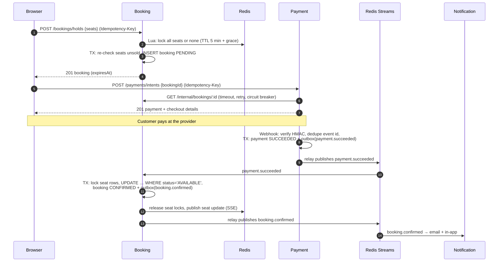

# Architecture

## Request path

```
Browser ──▶ (nginx / Vite) ──▶ Gateway ──▶ service
                                 │
                                 ├─ verifies JWT (HS256, issuer + audience checked)
                                 ├─ strips client-sent x-user-* / x-internal-token headers
                                 ├─ sets x-user-id, x-user-role, x-user-email, x-user-name
                                 ├─ adds x-internal-token and x-request-id
                                 └─ rate limits (sliding window in Redis)
```

**Authentication happens once (gateway). Authorization happens next to the data (each service).** The booking service is the one that knows a booking belongs to a user, so it is the one that checks.

Every service logs JSON with the request id, so one id follows a request across all services.

## Data ownership

| Store | Owner | What |
|---|---|---|
| Postgres `showtime_auth` | auth | users, refresh_tokens |
| MongoDB `showtime_catalog` | catalog | movies, venues (screens + layouts), shows |
| Postgres `showtime_booking` | booking | shows (read model), show_seats, bookings, outbox, idempotency_keys |
| Postgres `showtime_payment` | payment | payments, webhook_events, outbox, idempotency_keys |
| Redis | shared instance, separate key prefixes | seat locks, event streams, catalog cache, rate limits, pub/sub, notification inbox |

Why MongoDB for the catalog? Venues carry nested, variable seat layouts and the data is read-heavy with no cross-document transactions. Why Postgres for bookings and payments? Money and seat sales need ACID transactions, row locks, unique constraints and `CHECK` constraints.

The booking service keeps its **own copy** of show data (built from `show.created` events), so the hot path never calls the catalog synchronously.

## Booking saga (happy path)



## Failure paths

| What goes wrong | What happens |
|---|---|
| Someone else holds a seat | Lua script returns the conflicting seats → `409 SEATS_UNAVAILABLE {seatIds}`; nothing is locked |
| Seat sold between check and lock | Re-check inside the insert transaction → 409, locks released |
| User never pays | Sweeper marks booking `EXPIRED` → `booking.expired` → payment cancels the open intent; Redis TTL frees locks even if the service died |
| Card declined | `payment.failed` → booking `FAILED`, seats released |
| Payment lands after expiry | Booking is no longer `PENDING` → `booking.failed {refundRequired: true}` → payment refunds |
| Payment lands but seats somehow taken | Conditional update finds seats not `AVAILABLE` → booking `FAILED` → refund |
| Customer cancels (≥ 2 h before) | Seats released in DB, `booking.cancelled {refundRequired}` → refund → `payment.refunded` → notification |
| Venue cancels the show | `show.cancelled` → booking cancels every active booking (ignoring cut-off) → refunds |
| Webhook delivered 3 times | `webhook_events` primary key turns duplicates into no-ops |
| Service crashes after DB commit, before publishing | Event is still in the outbox; relay publishes it on the next tick |
| Event handler keeps throwing | Message re-claimed and retried; after 5 deliveries → `dlq:<topic>:<group>` |
| Booking service down during payment start | Client retries with backoff, then circuit opens → `503` fast instead of hanging |

## Events

| Event | Producer | Consumers |
|---|---|---|
| `show.created` | catalog | booking (builds seat inventory) |
| `show.cancelled` | catalog | booking (cancel + refund all) |
| `booking.confirmed` | booking | notification |
| `booking.failed` | booking | payment (refund if required), notification |
| `booking.expired` | booking | payment (cancel open intent), notification |
| `booking.cancelled` | booking | payment (refund if required), notification |
| `payment.succeeded` | payment | booking |
| `payment.failed` | payment | booking |
| `payment.refunded` | payment | notification |

Delivery is **at-least-once**. Every handler is idempotent: state checks in booking/payment ("already confirmed? do nothing"), `SET NX` per event id in notification.

## Where state lives during a booking

| Moment | Redis | Postgres |
|---|---|---|
| Seats chosen, not held | – | seats `AVAILABLE` |
| Held | `seatlock:{show}:A7 = bookingId` (TTL) | booking `PENDING`, seats `AVAILABLE` |
| Paid + confirmed | lock deleted | booking `CONFIRMED`, seats `BOOKED` with `booking_id` |
| Cancelled | – | booking `CANCELLED`, seats `AVAILABLE` |

Redis answers "is anyone in the middle of buying this?" (fast, temporary). Postgres answers "who owns this seat?" (durable, authoritative). A `CHECK` constraint guarantees a `BOOKED` seat always has a `booking_id`.

## Scaling notes

- All services are stateless; run as many replicas as needed.
- Expiry sweeper and outbox relay use `FOR UPDATE SKIP LOCKED`, so replicas share work instead of duplicating it.
- Consumer groups spread events across replicas of the same service.
- SSE: any replica can serve any browser; seat changes fan out through Redis pub/sub.
- Seat lock keys use a hash tag `{showId}`, so a show's seats land on one Redis Cluster slot (multi-key Lua stays legal if Redis is sharded).
- Catalog reads are cached with generational keys; one `INCR` invalidates everything after a write.
