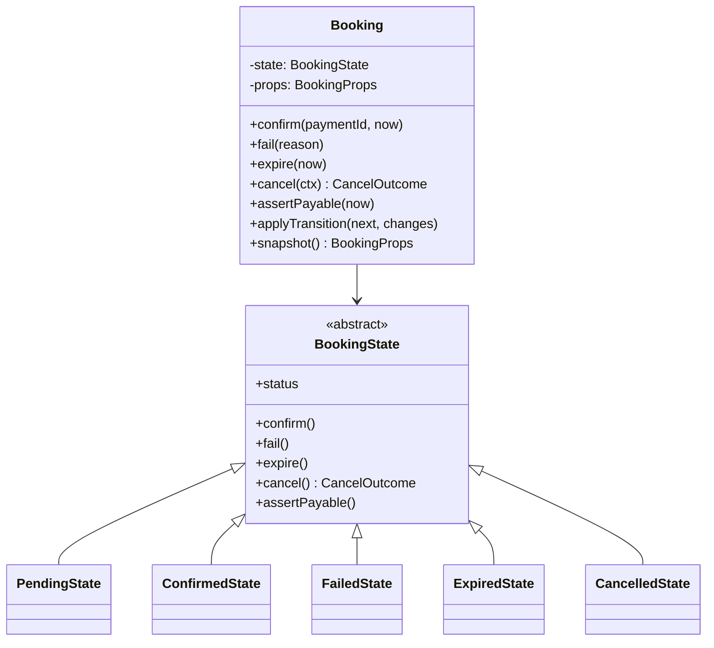
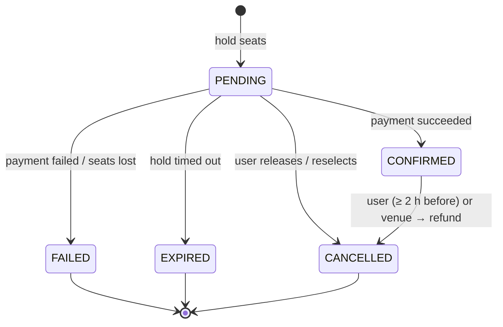
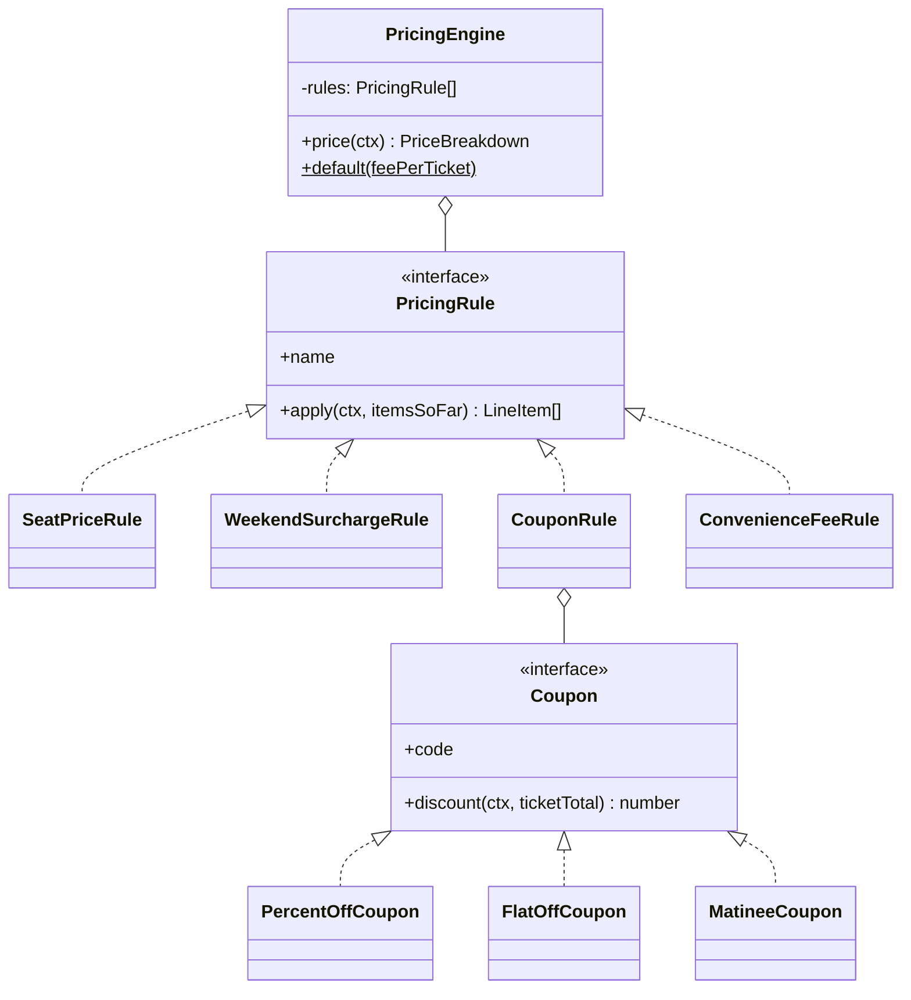
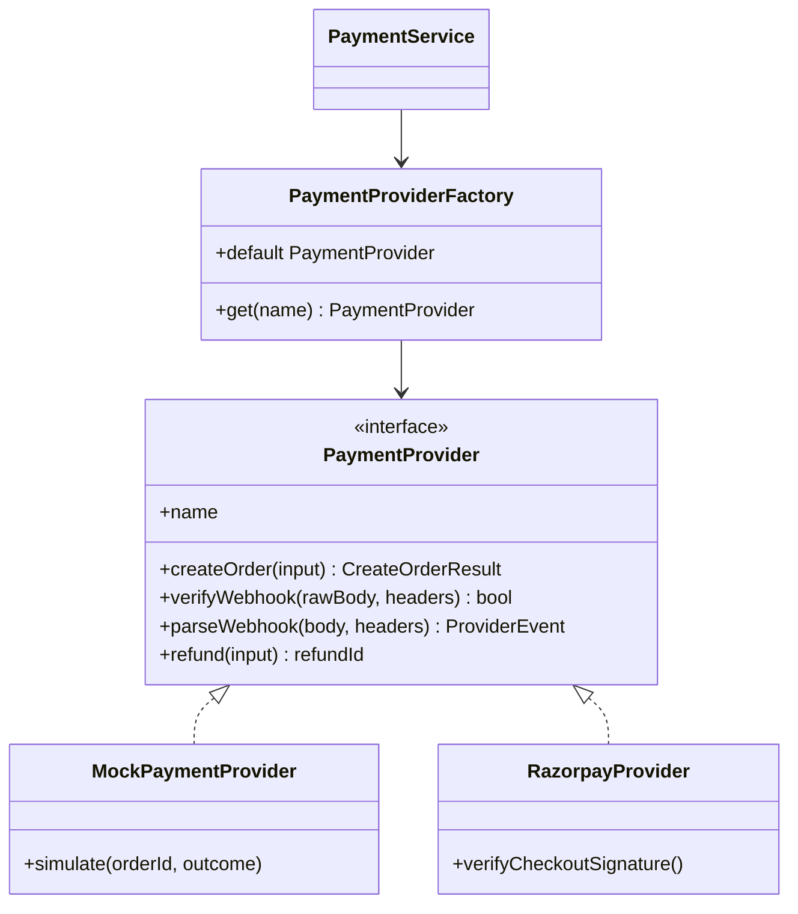
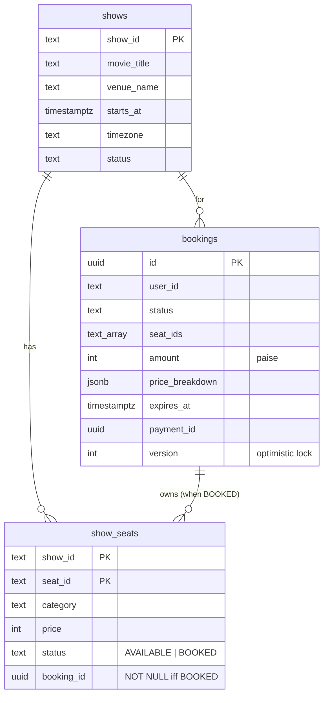

# Low-level design

The patterns below are used because the problem calls for them, not as decoration. Each section says what problem it solves and where to find it.

## Booking aggregate + State pattern

`services/booking/src/domain/`

**Why:** the base class rejects every action, and each state overrides only what is legal from it. "Confirm an expired booking" cannot happen by accident; it throws `InvalidStateTransitionError` (HTTP 409). Adding a status (say `REFUND_PENDING`) means adding a class, not hunting through `if (status === …)` checks.

`Booking` has no status setter. The only way to change status is through a state object calling `applyTransition`.

## Pricing: Strategy pattern

`services/booking/src/domain/pricing.ts`

Rules run in order and see the line items produced so far. That ordering is the design: discounts apply to tickets + surcharge, and fees and GST come after. Money is always integer paise. Day-of-week and hour come from the **venue's timezone**, not the server's.

## Payment providers: Strategy + Factory

`services/payment/src/providers/`

`PaymentService` never branches on provider type. The mock provider produces real HMAC-signed webhooks that go through the same verification and processing code as Razorpay's.

## Notifications: Observer + Strategy

`services/notification/src/`

- Observer: the service subscribes to domain events; other services do not know it exists. Adding SMS means a new subscriber, with zero changes to booking or payment.
- `NotificationChannel` strategy: `EmailChannel` (SMTP), `ConsoleEmailChannel`, `InAppChannel` (Redis list).
- `NotificationDispatcher` claims `notif:sent:<eventId>` with `SET NX` before sending, so redelivered events never send a second email.

## Infrastructure building blocks

`packages/common/src/`

| Class | Pattern / idea | Used by |
|---|---|---|
| `EventPublisher` / `EventConsumer` | Pub/sub over Redis Streams consumer groups, retry via `XCLAIM`, DLQ | all event-driven services |
| `OutboxRelay` + `enqueueEvent` | Transactional outbox | booking, payment |
| `idempotent()` middleware | Idempotency keys | booking holds, payment intents |
| `CircuitBreaker` | Circuit breaker (CLOSED / OPEN / HALF_OPEN) | `ServiceClient` |
| `ServiceClient` | Timeout + retry with backoff and jitter (GET only) | payment → booking |
| `SeatLockManager` | Distributed lock (Lua compare-and-set, compare-and-delete) | booking |
| `SlidingWindowRateLimiter` | Sliding-window log in a sorted set | gateway |
| `CatalogCache` | Cache-aside, generational invalidation | catalog |

## Database schema (booking)

Constraints worth pointing at in an interview:

- `CHECK ((status = 'BOOKED') = (booking_id IS NOT NULL))`: a sold seat always has an owner.
- `UNIQUE (user_id, show_id) WHERE status = 'PENDING'`: one hold per user per show.
- `bookings_pending_expiry_idx … WHERE status = 'PENDING'`: partial index keeps the sweeper's scan tiny.
- Payment: `UNIQUE (booking_id) WHERE status = 'CREATED'`: at most one open payment per booking, enforced by the database.
